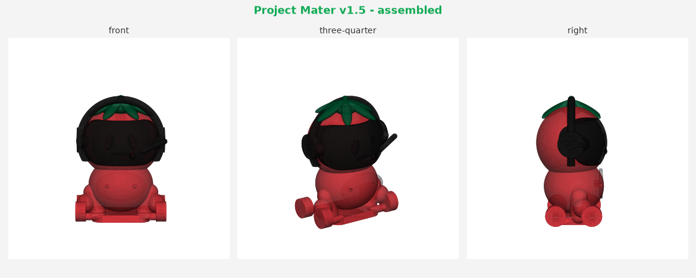
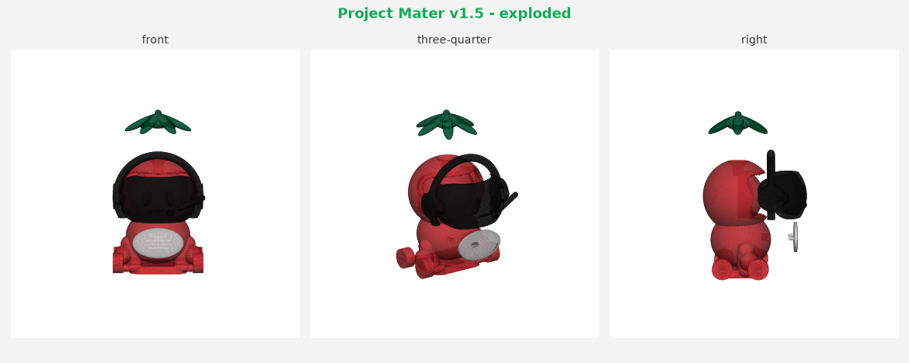

# Project Mater v1.5 — 4-piece 3D-print model (TomatoStar mascot)

A parametric, printability-first 3D model built **to the supplied engineering
package** (`docs/reference/`): the Engineering Brief + Dimension Schedule are the
source of truth; the concept turnaround is used for appearance only, with written
requirements winning any conflict.

Geometry is generated with `trimesh` + `manifold3d` and exported to **3MF** (one
per part + an assembled 3MF) and **STL** (printer interchange). It is a *stylised*
interpretation — clean geometric forms conforming to the nominal dimensions — not
a surface-exact copy of the studio render.




## Parts & files (`output/`)

| # | Part | Color (PLA) | File | Key features |
|---|------|-------------|------|--------------|
| 1 | Body | Morning Star red | `01_Body_Red.3mf` | Tomato head + torso + arms + 4 decorative wheels + hidden flat base; curved face recess, chest badge recess, keyed calyx socket, glue-relief |
| 2 | Faceplate | Black | `02_Faceplate_Black.3mf` | Curved 58×36 panel, recessed eyes + smile, **integrated headset** (ear cups, headband, mic boom), 4 back locating pins |
| 3 | Logo badge | White | `03_Logo_Badge_White.3mf` | 40×24 raised oval, 2 anti-rotation pins |
| 4 | Calyx | Morning Star green | `04_Calyx_Green.3mf` | Thick blended leaves draping the crown, **keyed cross peg** + shoulder stop |
| — | Assembly (view only) | — | `Mater_v1_5_Assembly.3mf` | All four parts colored, in position |
| — | FDM fit coupon | any | `Mater_FDM_Fit_Coupon.3mf` | Print FIRST to pick clearances |

Brand colors sampled from the Morning Star reference: red `#E13940`, green `#00693F`.

## Verified against spec

| Check | Target | Built |
|-------|--------|-------|
| Assembled envelope | 72 × 60 × 100 mm | ~72.7 × 57 × 101 mm |
| Body height (no calyx) | 92 mm | ~91 mm |
| Faceplate visible | 58 × 36 mm | 58 × 36 mm |
| Logo badge | 40 × 24 mm | 40 × 24 mm |
| Calyx | 52 w × 34 h mm | ~53 × 31 mm |
| All parts | watertight, single body | ✅ |
| Hidden flat base | carries weight, wheels float | base at z=0, wheels +0.5 mm |

Run `python3 scripts/validate.py` for the live report (integrity, envelope,
clearances, dry-fit interference).

## Critical process — validate fits before freezing (from the brief §4)

1. **Print `Mater_FDM_Fit_Coupon`** on the exact printer / nozzle / filament /
   profile planned for Mater.
2. Pick the clearance that gives a firm hand fit (no tools, no rattle).
3. Put that value into `scripts/params.py` (`FACE_CLEAR`, `BADGE_CLEAR`,
   `CALYX_CLEAR`) and rebuild. Current nominals: faceplate/badge **0.20 mm**,
   calyx **0.25 mm** per side (top-facing sockets print tighter).
4. Print Prototype A at 100 mm, dry-fit, adjust by 0.05–0.10 mm as needed.
5. Freeze only after a full dry-fit + glue test.

## Assembly (slip-fit + CA glue)

Geometry does the alignment; glue only retains. Dry-fit everything first.

1. **Faceplate → body:** 4 pins into the face-recess holes; panel bottoms on the
   perimeter shoulder. One or two micro-drops of gel/medium CA in the relief
   pockets — never on the visible perimeter.
2. **Badge → chest:** 2 pins into the chest holes (can't rotate); sits ~0.5 mm
   proud with a ~0.25 mm shadow line.
3. **Calyx → top:** keyed cross peg into the socket (only one orientation);
   shoulder bottoms on the head.
4. **Optional:** fill the recessed eyes/smile with white paint pen or UV resin.

## Print settings (from the brief §5)

- Process: FDM/FFF, PLA · Nozzle 0.4 mm
- Layer: 0.20 mm prototype / 0.12–0.16 mm presentation
- Infill 15–20 %, min cosmetic wall 2.5 mm
- Orientation: **body** upright on hidden base · **faceplate** visible-face up ·
  **badge** flat back on bed, logo up · **calyx** peg-up to minimise leaf supports
- Avoid supports on visible face/head surfaces

### Logo note
The white badge is a single-color part; it cannot reproduce the red/green
TomatoStar logo by itself. Decorate with a color/UV print, waterslide decal, or
multicolor filament — and obtain the original vector artwork from Morning Star.

## Rebuild from source

```bash
pip install numpy trimesh manifold3d networkx lxml shapely mapbox_earcut scipy matplotlib
cd scripts
python3 build_all.py        # builds all parts + coupon + assembly + validation
```

`scripts/params.py` holds every nominal dimension and clearance — edit there and
all mating features stay consistent. `scripts/common.py` has the geometry
helpers. `docs/reference/` contains the original engineering package (incl. the
authoritative OpenSCAD fit coupon).

## Revision naming (brief §6)

`Mater_v1_5_A` (this — first printable) → `_B` (fit correction) → `_RC1` →
`_R1` (approved). Record printer, filament, nozzle, slicer profile, and the
selected clearance with every prototype.
